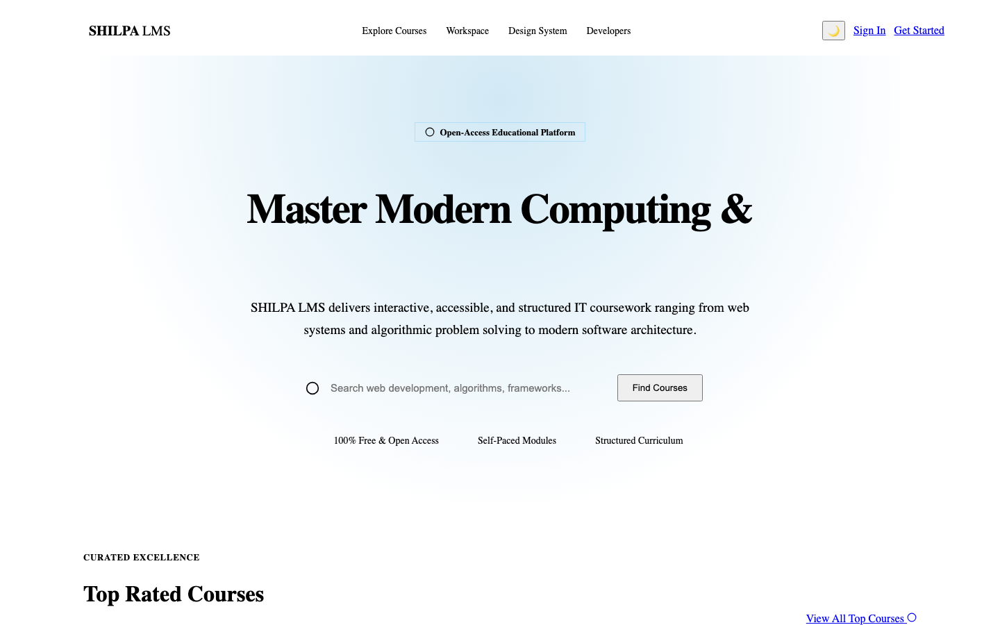
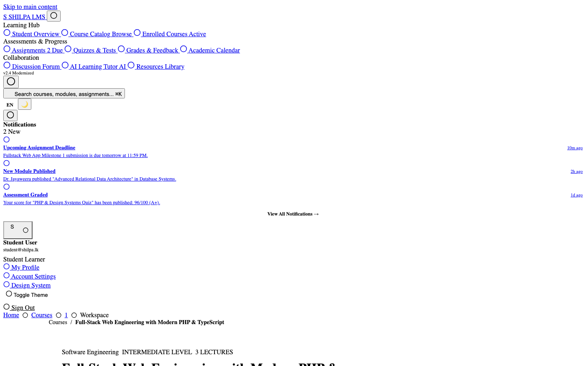
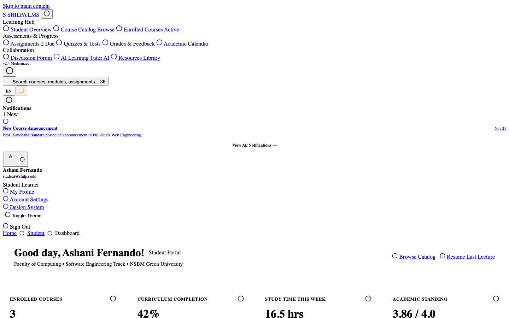
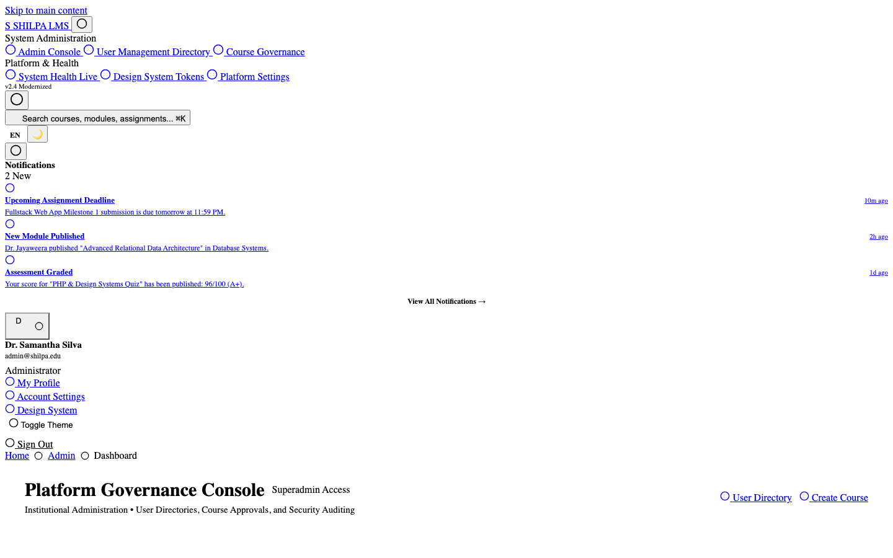
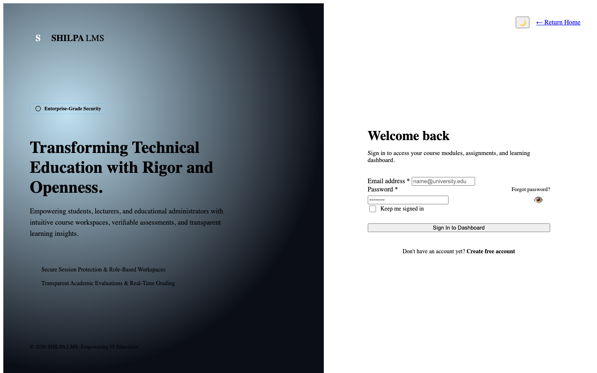

# SHILPA LMS — Enterprise Learning Management System

<div align="center">



<p align="center">
  <strong>A modern, visually impressive, secure, scalable, and intelligent Learning Management System.</strong><br>
  Built for universities, educational institutions, enterprise training academies, and lifelong learners.
</p>

[](https://www.php.net/)
[](https://www.mysql.com/)
[](https://redis.io/)
[](https://www.docker.com/)
[]()
[]()
[]()

</div>

---

## 🌟 Executive Overview

**SHILPA LMS** is an enterprise-grade educational SaaS platform completely modernized through an incremental, 34-phase engineering transformation. It unites institutional power with the sleek, responsive, and intuitive interaction standards of premier modern platforms such as Linear, Notion, and Stripe.

With zero third-party framework bloat, SHILPA LMS is powered by a high-performance modern PHP 8.2+ MVC architecture, hardened against the OWASP Top 10, featuring cryptographically verifiable audit trails, multi-factor authentication, background job processing, intelligent course discovery, and an AI-powered learning assistant.

---

## 📸 Application Preview

### 1. Landing Page & Course Discovery
A responsive public experience featuring dynamic hero sections, verified institutional metrics, curated course highlights, and seamless search.


---

### 2. Intelligent Course Catalog & Smart Filtering
Comprehensive course browsing with category faceted search, level filtering, instructor badges, and real-time query matching.


---

### 3. Course Learning Workspace & Content Theater
An immersive distraction-free workspace with structured curriculum navigation, free previews, interactive modules, and multimedia lessons.



---

### 4. Advanced Student Dashboard
Personalized learning cockpit featuring enrolled courses, completion percentages, upcoming deadlines, recent announcements, and velocity insights.



---

### 5. Institutional Admin Dashboard & Cryptographic Security Audit
Centralized operations console providing system health metrics, queue monitoring, user directory management, and HMAC-SHA256 audit log verification.



---

### 6. Design System & Component Library
A unified, accessible token-driven design system featuring accessible color scales, custom form controls, alerts, modals, badges, and responsive layouts.


---

### 7. Modern Authentication & Security
Brute-force protected sign-in with 2FA TOTP support, CSPRNG CSRF protection, and smooth onboarding workflows.



---

## 🚀 Key Feature Highlights

### 🛡️ Enterprise Security & Application Hardening
- **OWASP Hardened Security Headers**: Strict `Content-Security-Policy`, `X-Frame-Options: DENY`, `X-Content-Type-Options: nosniff`, and `Permissions-Policy`.
- **Cryptographic Audit Trail**: Tamper-evident security event logs chained sequentially via HMAC-SHA256 signatures with automated verification.
- **Role-Based Access Control (RBAC)**: Fine-grained declarative policy gates (`App\Security\Gate`) governing Student, Lecturer, and Admin privileges.
- **Session Protection**: Strict `SameSite=Lax`, `HttpOnly`, 128-bit CSPRNG token entropy, and session regeneration on privilege escalation.
- **Rate Limiting & Anti-Brute-Force**: Leaky-bucket throttle middleware protecting authentication and API endpoints.

### 📚 Curriculum & Learning Experience
- **Module & Lesson Builder**: Drag-and-drop hierarchy builder supporting text, code, video, and downloadable resources.
- **Learning Theater**: Distraction-free learner UI with keyboard navigation, progress persistence, and lesson completion checkoffs.
- **Assessment & Question Bank**: Timed quizzes, multiple-choice question banks, instant scoring, and attempt history.
- **Assignments & Submissions**: Rich text and file upload submissions, deadline enforcement, and faculty grading with qualitative feedback.
- **Weighted Gradebook**: Automatic grade calculation, percentage letter-grade mapping ($A^+$ to $F$), and verifiable transcripts.

### 💬 Community & Collaboration
- **Course Announcements**: Pinned instructor broadcasts with instant notifications.
- **Discussion Threads**: Contextual Q&A forums organized per course with nested replies.
- **Direct Messaging**: Private communication between students and faculty with unread badges.
- **Notification Center**: Centralized inbox supporting real-time alerts and email dispatch preferences.

### 🤖 Intelligence & Analytics
- **AI-Powered Learning Assistant**: Context-aware tutoring with lesson summarization, practice question generation, and concept clarification.
- **Intelligent Discovery Engine**: Course recommendation blending affinity scores, user bookmarks, and curated learning pathways.
- **Learning Velocity & Retention**: Early-warning indicators for at-risk learners and comprehensive institutional completion analytics.
- **Command Palette (`Ctrl/Cmd + K`)**: Global modal search indexing courses, lessons, users, and platform administrative actions.

### ⚡ Performance, Scalability & Background Jobs
- **Tagged Caching**: Dual-driver cache architecture (Memory/File/Redis) with tag-based invalidation.
- **Asynchronous Queue Pipeline**: Reliable background processing (`bin/queue-worker`) for transactional emails, notifications, and analytics events.
- **Reliable Storage**: Unified storage abstraction (`App\Storage\StorageManager`) with size validation, MIME allowlists, and path traversal guards.
- **Accessibility & Internationalization**: WCAG 2.1 AA compliant contrast, dark/light theme persistence, and localization engine (`__()`).

---

## 🛠️ Technology Architecture

```
SHILPA-LMS/
├── app/
│   ├── Controllers/     # Thin HTTP Controllers (REST & Views)
│   ├── Core/            # Kernel, Router, Request, Response, Container
│   ├── Database/        # QueryBuilder, Connection, Migrations, Schema
│   ├── Models/          # Active Record Data Models & Relationships
│   ├── Security/        # Gate, Sanitizer, PasswordService, AuditLog
│   ├── Services/        # Domain Business Logic & Workflows
│   ├── Cache/           # TaggedCache, FileCache, ArrayCache
│   ├── Queue/           # QueueManager, DatabaseQueue, SyncQueue, Worker
│   ├── Storage/         # StorageManager, LocalDisk, DiskInterface
│   └── Testing/         # Test harness, Assertions, TestResponse
├── database/
│   └── migrations/      # 26 Sequential, idempotent database migrations
├── docker/
│   ├── nginx.conf       # Hardened reverse proxy configuration
│   ├── php.ini          # Tuned production OPcache & runtime settings
│   └── entrypoint.sh    # Container startup, migration & permission handler
├── public/              # Web root (index.php, static CSS/JS, router.php)
├── resources/           # Presentation views, layouts, and components
├── screenshots/         # High-resolution application preview captures
├── storage/             # Application cache, logs, sessions, and uploads
├── tests/
│   ├── Unit/            # Isolated unit test suites
│   └── Feature/         # End-to-end integration & acceptance tests
├── bin/
│   ├── test             # Automated CLI test runner (152 test suites)
│   ├── code_quality.php # Static analysis & syntax validation gate
│   ├── deploy-verify    # 14-point production readiness verifier
│   ├── load-test        # Synthetic load & concurrency benchmark runner
│   ├── queue-worker     # Long-lived background queue daemon
│   └── migrate.php      # CLI database migration runner
├── Dockerfile           # Multi-stage production container build
└── docker-compose.yml   # Multi-service production stack orchestration
```

---

## 🚀 Quick Start Guide

### Option 1: Docker (Recommended for Production)

Run the full multi-service production stack (App, Web, MySQL 8.0, Redis, and Queue Worker) in one command:

```bash
# 1. Clone the repository
git clone https://github.com/SadeeshaJayaweera/SHILPA-LMS.git
cd SHILPA-LMS

# 2. Copy the production environment template
cp .env.production.example .env

# 3. Build and launch all services
docker-compose up -d --build

# 4. Access the application in your browser
open http://localhost
```

---

### Option 2: Local Development Environment

**Requirements:**
- PHP 8.2 or higher (`pdo`, `mbstring`, `openssl`, `json`, `ctype`, `session`)
- Composer 2.x
- MySQL 8.0+ or SQLite3

```bash
# 1. Clone repository & install dependencies
git clone https://github.com/SadeeshaJayaweera/SHILPA-LMS.git
cd SHILPA-LMS
composer install

# 2. Configure environment
cp .env.example .env

# 3. Run database migrations
php bin/migrate.php

# 4. Start local development server
php -S 127.0.0.1:8000 public/router.php

# 5. Open in browser
open http://127.0.0.1:8000
```

---

## 🧪 Verification & Quality Assurance

SHILPA LMS adheres to rigorous automated quality standards:

### Run the Full Automated Test Suite
```bash
php bin/test
```
*Executes all 152 unit and feature tests across authentication, RBAC, curriculum builder, grading, security audits, caching, and background queues.*

### Run Code Quality & Syntax Validation
```bash
php bin/code_quality.php
```
*Validates syntax, strict typing, and structure across all 199 PHP source files.*

### Run Production Deployment Verifier
```bash
php bin/deploy-verify
```
*Performs an automated 14-point pre-flight checklist validating runtime extensions, directory write permissions, database connectivity, schema tables, and cache/queue drivers.*

### Run Synthetic Concurrency & Load Benchmark
```bash
php bin/load-test --requests=500 --concurrency=10
```
*Simulates concurrent client requests to measure throughput (req/s) and P95/P99 latency distribution.*

---

## 🔐 Security Vulnerability Reporting

If you discover a security vulnerability within SHILPA LMS, please report it privately to `security@shilpalms.com`. All security advisories are evaluated promptly and patches are cryptographically audited before deployment.

---

## 📄 License & Credits

The SHILPA Learning Management System is an open-source platform licensed under the **MIT License**.

Modernized with meticulous engineering craft by the **SHILPA LMS Engineering Team**.
