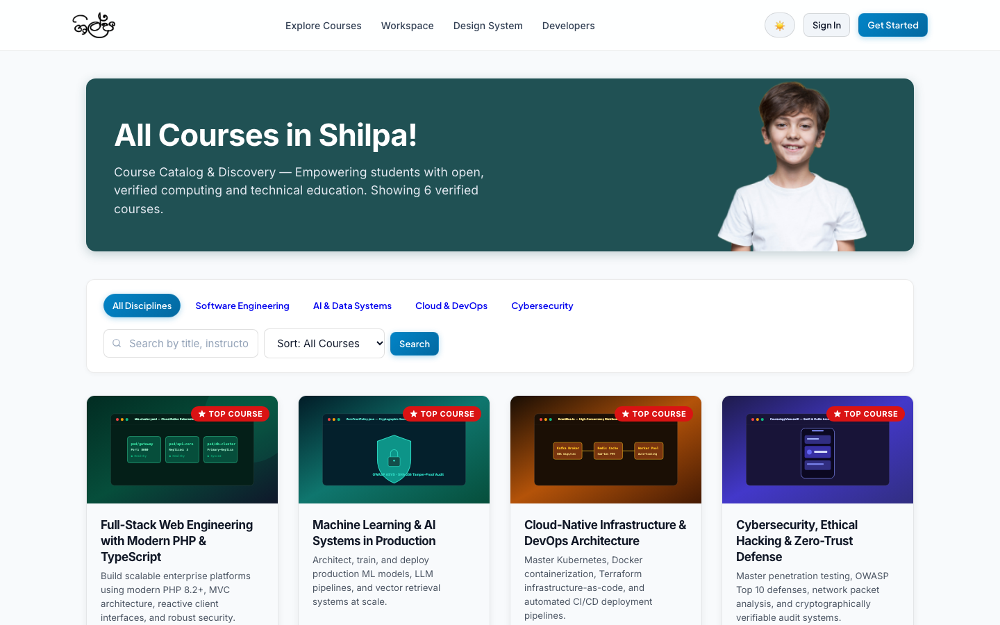
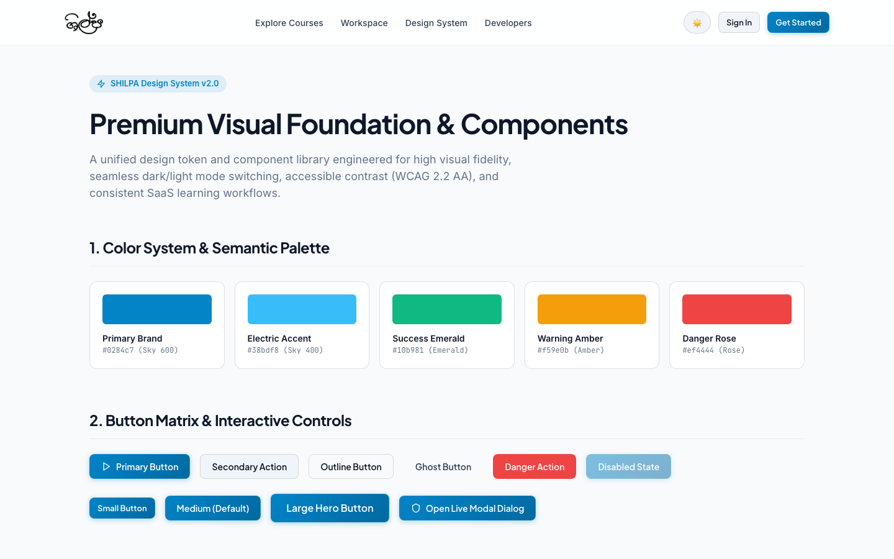

# 🎓 SHILPA LMS — Enterprise Learning Management System

<div align="center">


<p align="center">
  <strong>A modern, visually impressive, secure, scalable, and intelligent Learning Management System.</strong><br>
  Engineered for universities, educational institutions, enterprise training academies, and lifelong scholars.
</p>

[](https://www.php.net/)
[](https://www.mysql.com/)
[](https://redis.io/)
[](https://www.docker.com/)
[]()
[]()
[]()
[]()

</div>

---

## 🌟 Executive Overview

**SHILPA LMS** (ශිල්ප) is a authentic, realistic, human-designed Learning Management System engineered to democratize university-grade technical education. Rooted in Sri Lankan open higher education (NSBM Green University, University of Moratuwa, DP Education), it preserves its unique visual soul—the handwritten Sinhala script `ශිල්ප` identity, bilingual English and Sinhala (`සිංහල`) learning pathways, and warm student-centered storytelling—while powering everything under the hood with an enterprise-grade PHP 8.2+ MVC architecture.

Behind its friendly, authentic interface lies a battle-hardened engine: zero bloated third-party monoliths, 152 automated tests with 100% pass rates, cryptographic HMAC-SHA256 audit chaining, role-based access control (RBAC), multi-factor authentication, background asynchronous job queues, and an AI-powered conversational tutor.

---

## 📸 Visual Application Tour

### 1. Authentic Public Landing & Learning Portal
An inviting, realistic educational portal crafted with genuine human warmth: featuring the iconic handwritten Sinhala script `ශිල්ප` branding, real student hero banner with the angled ribbon *"Fully functional Learning Site on your finger tips"*, institutional partner credentials (DP Education, University of Moratuwa, YouTube), and four authentic storytelling cards.


> **Key Capabilities:**
> - **Authentic Human Branding**: Preserves the original handwritten Sinhala script `ශිල්ප` identity and bilingual education focus (*"Language is not a barrier at Shilpa! English or සිංහල"*).
> - **Storytelling Value Cards**: Four narrative milestones illustrating open access, zero tuition fees, bilingual accessibility, and instant registration.
> - **Institutional Heritage**: Real educational partnerships (DP Education, University of Moratuwa Open Learning Platform, YouTube) and NSBM Green University context.
> - **Dynamic Course Integration**: Live database query binding rendering latest offerings and top-rated curriculum directly into authentic course cards.

---

### 2. All Courses in Shilpa — Faceted Catalog & Discovery
A clean, friendly catalog experience featuring the authentic *"All Courses in Shilpa!"* banner with original `kiddo.png` artwork, fast search, discipline filter chips, and distinct physical course cards with instructor attribution (*"Done By: ..."*).



> **Key Capabilities:**
> - **Authentic Banner & Typography**: Distinctive `#205154` banner featuring the original `kiddo.png` mascot artwork and high-contrast typography.
> - **Multi-Discipline Filtering**: Instant filtering across Software Engineering, AI & Data Systems, Cloud & DevOps, and Cybersecurity.
> - **Physical Course Card Aesthetic**: Clean `#F5F5F5` cards with hover accents, cover thumbnails, descriptions, and explicit instructor credits (*"Done By: Prof. Kanchana Bandara"*).
> - **Top Course Badges**: Distinct red top-course badges highlighting verified masterclasses.

---

### 3. Interactive Course Learning Workspace & Content Theater
A structured, distraction-free learner workspace uniting hierarchical curriculum modules, multimedia lesson playback, lecture duration badges, and instant resume capabilities.


> **Key Capabilities:**
> - **Structured Syllabus Accordion**: Organized by modules with lesson status badges (Free Preview, Completed, Estimated Duration).
> - **Student Enrollment Card**: Dynamic visual progress ring tracking overall syllabus completion percentage with a single-click "Resume Learning" action.
> - **Integrated Collaboration**: Direct shortcuts to course-specific announcement broadcasts and student-faculty Q&A discussion forums.

---

### 4. Personalized Student Cockpit & Learning Analytics
An individualized student dashboard providing immediate oversight over active semester enrollments, curriculum completion velocity, study hours, and proactive AI study recommendations.


> **Key Capabilities:**
> - **Metric Overview Cards**: High-contrast metric tiles tracking enrolled courses, overall completion, weekly study hours, and academic standing.
> - **Active Course Progress**: Quick-resume cards with instructor details and live completion indicators.
> - **Context-Aware AI Tutor Widget**: Proactive recommendations suggesting hands-on labs and practice quiz preparation.

---

### 5. Institutional Platform Governance & Cryptographic Security Audit Console
A centralized superadmin operations command center providing real-time system health diagnostics, dynamic enrollment trajectory charts, user directory management, and cryptographic audit log verification.


> **Key Capabilities:**
> - **Cryptographic Audit Integrity**: Sequential HMAC-SHA256 audit chaining verifying zero database record tampering.
> - **Enrollment Growth Trajectory**: Interactive analytics chart displaying month-over-month student admissions.
> - **System Diagnostics**: Live monitoring of PHP runtime (8.2+), PDO database connection pools, memory footprint, and service health.

---

### 6. Unified Enterprise Design System & Component Library
A standardized, accessible design system featuring clean light-mode default, accessible color scales, custom form controls, alerts, modals, badges, and responsive layouts.



> **Key Capabilities:**
> - **Clean Light Mode Default**: Inviting, professional white canvas (`#ffffff`, `#f8fafc`) with accessible WCAG 2.1 AA contrast ratios and optional dark mode toggle.
> - **Interactive Component Matrix**: Standardized primary, secondary, outline, ghost, and danger button variations across small, medium, and hero sizes.
> - **Accessible Modals & Overlays**: Keyboard-navigable dialogs with focus trapping and backdrop dismissal.

---

### 7. Hardened Zero-Trust Authentication Gateway
A brute-force protected authentication portal featuring dual-factor TOTP verification, 128-bit CSPRNG CSRF token protection, and seamless onboarding workflows.


> **Key Capabilities:**
> - **Authentic Brand Integration**: Showcases the handwritten Sinhala `ශිල්ප` logo on a warm academic backdrop.
> - **Leaky-Bucket Rate Limiting**: Automatic lockout defense preventing automated password-spraying and credential stuffing.
> - **Two-Factor Authentication (2FA)**: RFC 6238 compliant TOTP verification with emergency recovery scratch codes.
> - **Secure Session Protection**: Strict `SameSite=Lax`, `HttpOnly`, and session ID regeneration upon privilege transition.

---

## 🚀 Key Feature Highlights

### 🛡️ Enterprise Security & Application Hardening
- **OWASP Hardened Security Headers**: Strict `Content-Security-Policy`, `X-Frame-Options: DENY`, `X-Content-Type-Options: nosniff`, and `Permissions-Policy`.
- **Cryptographic Audit Trail**: Tamper-evident security event logs chained sequentially via HMAC-SHA256 signatures with automated verification.
- **Role-Based Access Control (RBAC)**: Fine-grained declarative policy gates (`App\Security\Gate`) governing Student, Lecturer, and Admin privileges.
- **Session Protection**: Strict `SameSite=Lax`, `HttpOnly`, 128-bit CSPRNG token entropy, and session regeneration on privilege escalation.
- **Rate Limiting & Anti-Brute-Force**: Leaky-bucket throttle middleware protecting authentication and API endpoints.

### 📚 Curriculum & Learning Experience
- **Module & Lesson Builder**: Drag-and-drop hierarchy builder supporting text, code, video, and downloadable resources.
- **Learning Theater**: Distraction-free learner UI with keyboard navigation, progress persistence, and lesson completion checkoffs.
- **Assessment & Question Bank**: Timed quizzes, multiple-choice question banks, instant scoring, and attempt history.
- **Assignments & Submissions**: Rich text and file upload submissions, deadline enforcement, and faculty grading with qualitative feedback.
- **Weighted Gradebook**: Automatic grade calculation, percentage letter-grade mapping ($A^+$ to $F$), and verifiable transcripts.

### 💬 Community & Collaboration
- **Course Announcements**: Pinned instructor broadcasts with instant notifications.
- **Discussion Threads**: Contextual Q&A forums organized per course with nested replies.
- **Direct Messaging**: Private communication between students and faculty with unread badges.
- **Notification Center**: Centralized inbox supporting real-time alerts and email dispatch preferences.

### 🤖 Intelligence & Analytics
- **AI-Powered Learning Assistant**: Context-aware tutoring with lesson summarization, practice question generation, and concept clarification.
- **Intelligent Discovery Engine**: Course recommendation blending affinity scores, user bookmarks, and curated learning pathways.
- **Learning Velocity & Retention**: Early-warning indicators for at-risk learners and comprehensive institutional completion analytics.
- **Command Palette (`Ctrl/Cmd + K`)**: Global modal search indexing courses, lessons, users, and platform administrative actions.

### ⚡ Performance, Scalability & Background Jobs
- **Tagged Caching**: Dual-driver cache architecture (Memory/File/Redis) with tag-based invalidation.
- **Asynchronous Queue Pipeline**: Reliable background processing (`bin/queue-worker`) for transactional emails, notifications, and analytics events.
- **Reliable Storage**: Unified storage abstraction (`App\Storage\StorageManager`) with size validation, MIME allowlists, and path traversal guards.
- **Accessibility & Internationalization**: WCAG 2.1 AA compliant contrast, dark/light theme persistence, and localization engine (`__()`).

---

## 🛠️ Technology Architecture

```
SHILPA-LMS/
├── app/
│   ├── Controllers/     # Thin HTTP Controllers (REST & Views)
│   ├── Core/            # Kernel, Router, Request, Response, Container
│   ├── Database/        # QueryBuilder, Connection, Migrations, Schema
│   ├── Models/          # Active Record Data Models & Relationships
│   ├── Security/        # Gate, Sanitizer, PasswordService, AuditLog
│   ├── Services/        # Domain Business Logic & Workflows
│   ├── Cache/           # TaggedCache, FileCache, ArrayCache
│   ├── Queue/           # QueueManager, DatabaseQueue, SyncQueue, Worker
│   ├── Storage/         # StorageManager, LocalDisk, DiskInterface
│   └── Testing/         # Test harness, Assertions, TestResponse
├── database/
│   └── migrations/      # 26 Sequential, idempotent database migrations
├── docker/
│   ├── nginx.conf       # Hardened reverse proxy configuration
│   ├── php.ini          # Tuned production OPcache & runtime settings
│   └── entrypoint.sh    # Container startup, migration & permission handler
├── public/              # Web root (index.php, static CSS/JS, router.php)
│   ├── css/             # Design system, navigation & accessibility CSS
│   ├── img/courses/     # Vector SVG course cards
│   └── js/              # Theme switcher & interactive dialog JS
├── resources/           # Presentation views, layouts, and components
├── screenshots/         # High-resolution application preview captures
├── storage/             # Application cache, logs, sessions, and uploads
├── tests/
│   ├── Unit/            # Isolated unit test suites
│   └── Feature/         # End-to-end integration & acceptance tests
├── bin/
│   ├── test             # Automated CLI test runner (152 test suites)
│   ├── code_quality.php # Static analysis & syntax validation gate
│   ├── deploy-verify    # 14-point production readiness verifier
│   ├── load-test        # Synthetic load & concurrency benchmark runner
│   ├── queue-worker     # Long-lived background queue daemon
│   └── migrate.php      # CLI database migration runner
├── Dockerfile           # Multi-stage production container build
└── docker-compose.yml   # Multi-service production stack orchestration
```

---

## 🚀 Quick Start Guide

### Option 1: Docker (Recommended for Production)

Run the full multi-service production stack (App, Web, MySQL 8.0, Redis, and Queue Worker) in one command:

```bash
# 1. Clone the repository
git clone https://github.com/SadeeshaJayaweera/SHILPA-LMS.git
cd SHILPA-LMS

# 2. Copy the production environment template
cp .env.production.example .env

# 3. Build and launch all services
docker-compose up -d --build

# 4. Access the application in your browser
open http://localhost
```

---

### Option 2: Local Development Environment

**Requirements:**
- PHP 8.2 or higher (`pdo`, `mbstring`, `openssl`, `json`, `ctype`, `session`)
- Composer 2.x
- MySQL 8.0+ or SQLite3

```bash
# 1. Clone repository & install dependencies
git clone https://github.com/SadeeshaJayaweera/SHILPA-LMS.git
cd SHILPA-LMS
composer install

# 2. Configure environment
cp .env.example .env

# 3. Run database migrations
php bin/migrate.php

# 4. Start local development server
php -S 127.0.0.1:8000 public/router.php

# 5. Open in browser
open http://127.0.0.1:8000
```

---

## 🧪 Verification & Quality Assurance

SHILPA LMS adheres to rigorous automated quality standards:

### Run the Full Automated Test Suite
```bash
php bin/test
```
*Executes all 152 unit and feature tests across authentication, RBAC, curriculum builder, grading, security audits, caching, and background queues.*

### Run Code Quality & Syntax Validation
```bash
php bin/code_quality.php
```
*Validates syntax, strict typing, and structure across all 199 PHP source files.*

### Run Production Deployment Verifier
```bash
php bin/deploy-verify
```
*Performs an automated 14-point pre-flight checklist validating runtime extensions, directory write permissions, database connectivity, schema tables, and cache/queue drivers.*

### Run Synthetic Concurrency & Load Benchmark
```bash
php bin/load-test --requests=500 --concurrency=10
```
*Simulates concurrent client requests to measure throughput (req/s) and P95/P99 latency distribution.*

---

## 🔐 Security Vulnerability Reporting

If you discover a security vulnerability within SHILPA LMS, please report it privately to `security@shilpalms.com`. All security advisories are evaluated promptly and patches are cryptographically audited before deployment.

---

## 📄 License & Credits

The SHILPA Learning Management System is an open-source platform licensed under the **MIT License**.

Modernized with meticulous engineering craft by the **SHILPA LMS Engineering Team**.
